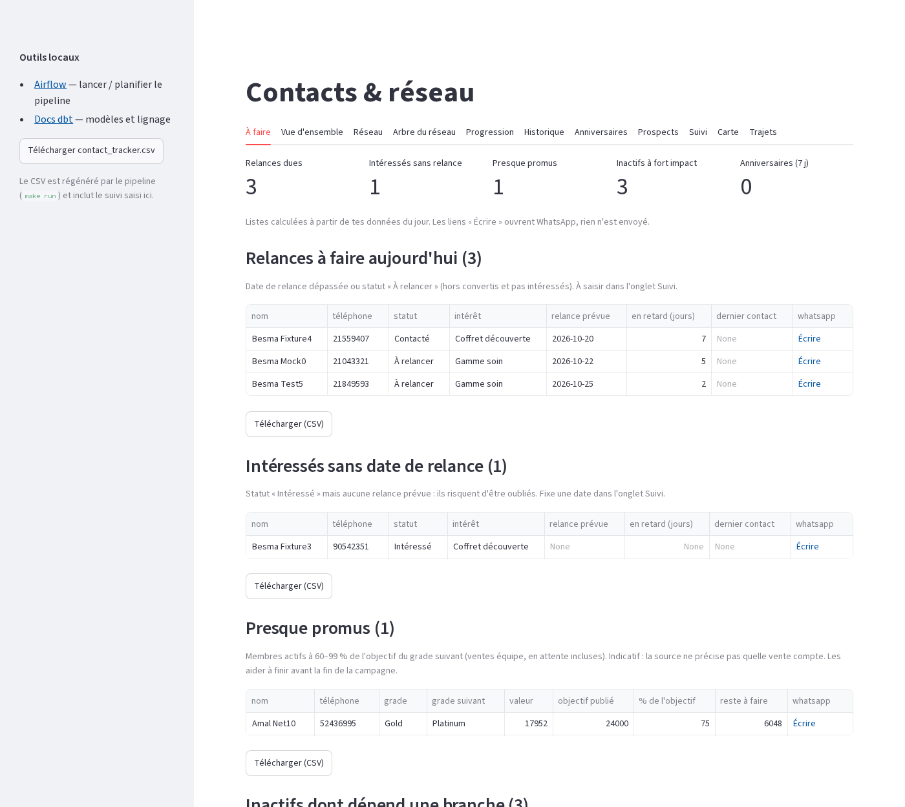
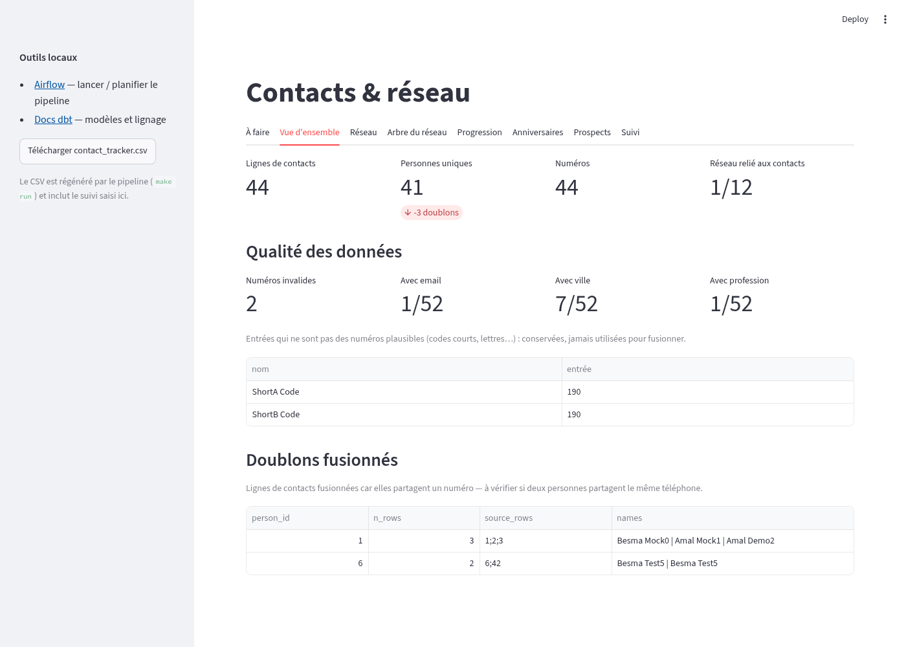
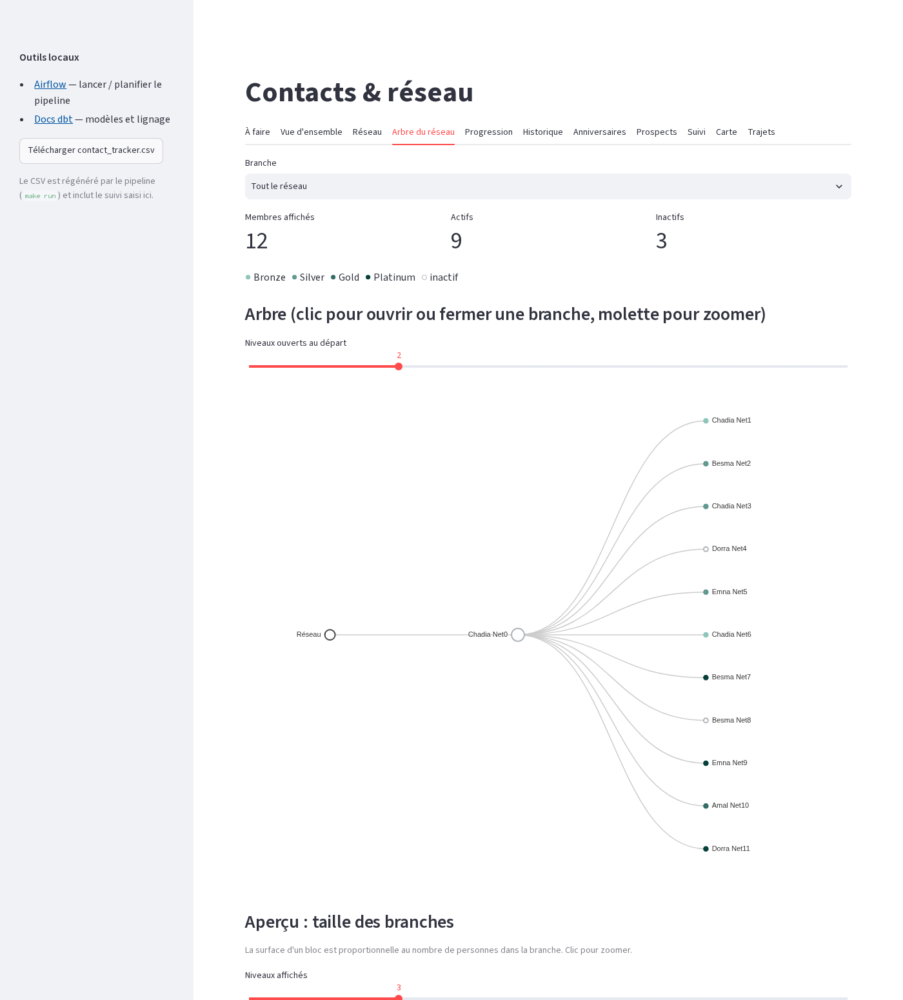
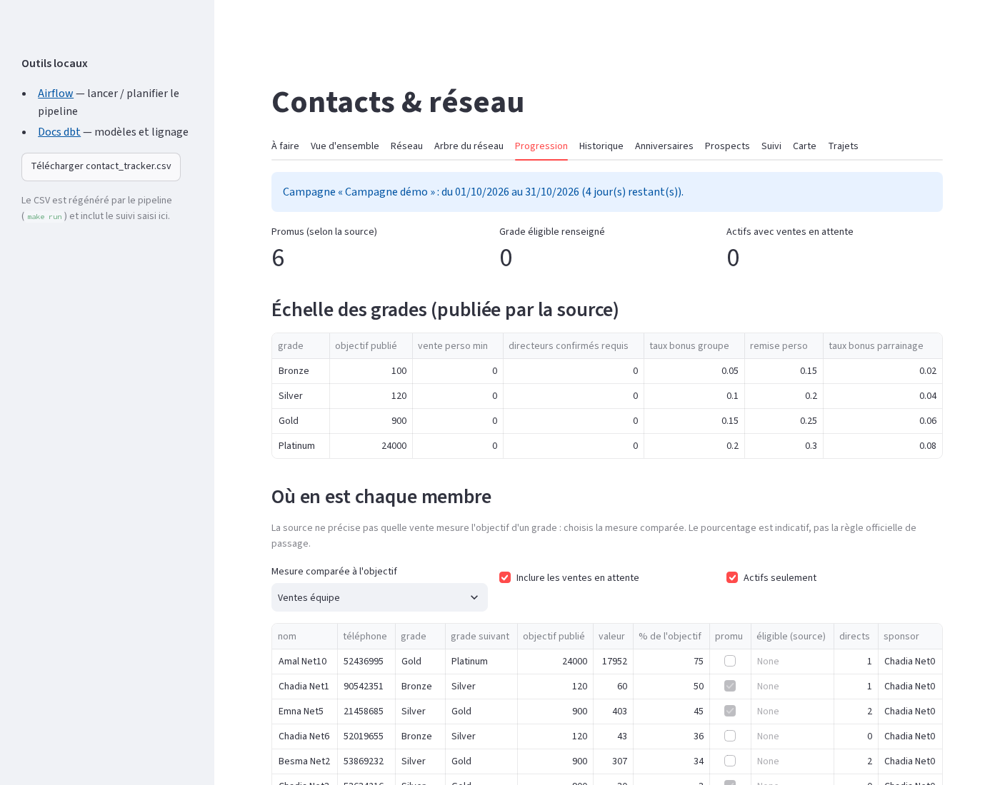
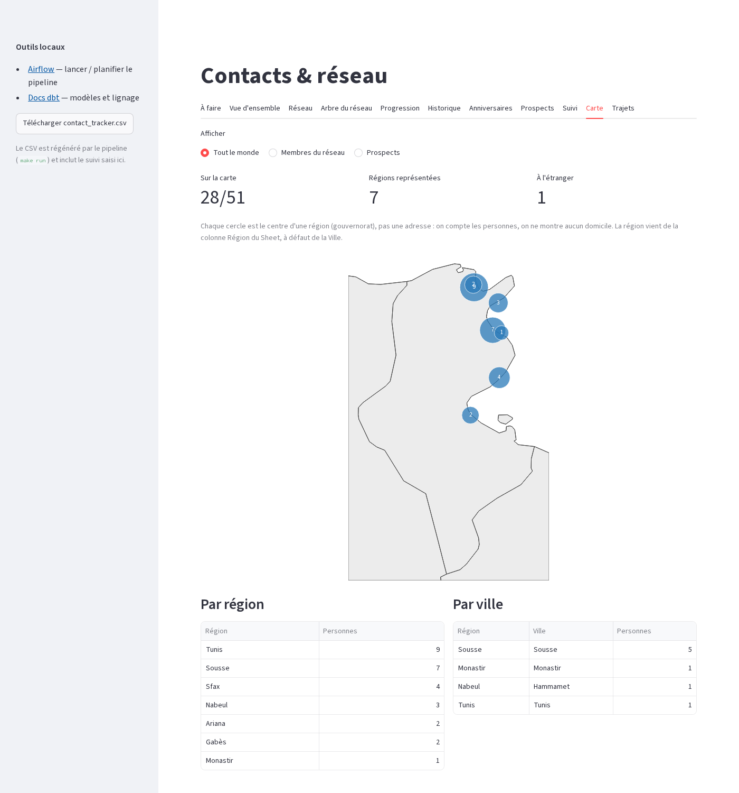
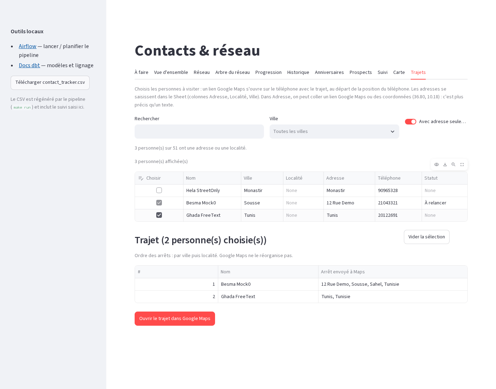
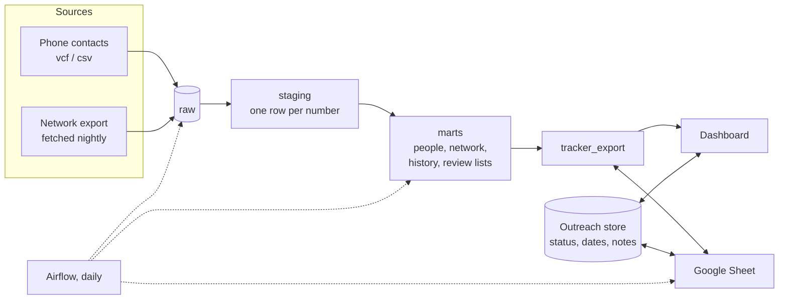
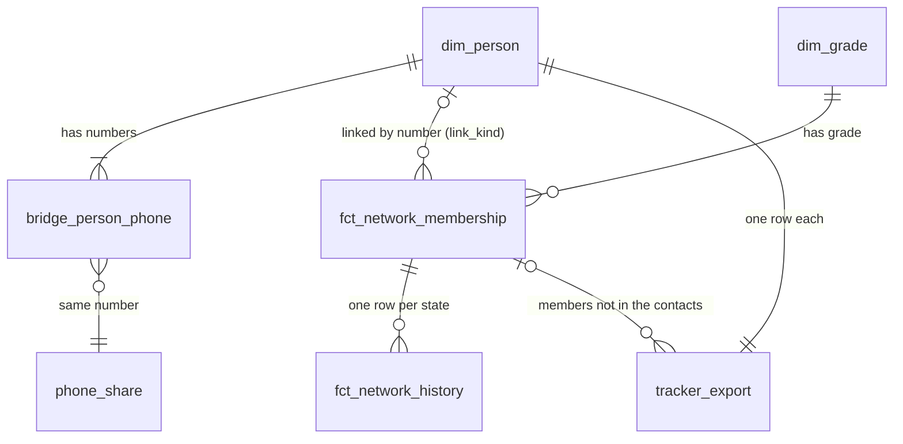

# contact-network-pipeline

A data pipeline and dashboard built with a member of a direct-selling company's sales network in
Tunisia, to support their day-to-day work: who to contact today, which members have gone inactive, and
how everyone is progressing towards the next grade. It merges their phone contacts with the network
export into one deduplicated list of people, never drops data silently, lists every merge for review,
and keeps sales, grades and activity over time. Because a spreadsheet is the tool they already know,
the same list lives in a shared Google Sheet that stays in step with the dashboard. It replaced a chain
of ad-hoc scripts.

The repository contains **no real data**. Contacts and network members are personal data, so real
exports and the warehouse stay out of git, and every screenshot below comes from synthetic fixtures.
The interface is in French, the language of its user.

| To do today | Overview and data quality |
|---|---|
|  |  |
| **Network tree** | **Grade progress** |
|  |  |
| **Map by region** | **Route builder** |
|  |  |

## The problem

The person I built this for works with two lists that don't line up: the contacts on their phone, and
the export of their sales network (who recruited whom, grades, sales). They need to know who to contact
today, which members have gone quiet, and who is close to the next grade. The chain of scripts they had
before could not answer that reliably, for three reasons:

- **Lost data.** The tracker had three phone columns and silently dropped a fourth number.
- **Duplicates.** The same person appears several times in a phone export, under different names and
  numbers, and merging them by hand does not scale.
- **A phone number is a channel, not an identity.** Members give their number to people under them for
  deliveries, so one number can belong to several people, and matching the two lists on the number
  alone links the wrong people. The design decisions below show how this changed the pipeline.

So the goal was not a prettier sheet but a pipeline that can say what it did, and fails loudly when
it loses something.

## What it lets you do

The dashboard follows one rule: **information, then decision, then action.** Each screen shows only what
supports a decision, and each decision ends in something you can do from the same screen.

| Information | Decision | Action |
|---|---|---|
| Overdue follow-ups, and interested people with no follow-up date | Who to contact today | Open a WhatsApp chat in one tap (nothing is sent automatically), then record the outcome |
| Inactive members, ranked by the size of the branch that depends on them | Which members are worth reactivating | Contact them, or note them for replacement |
| Members at 60-99% of the next grade, with what is left to do | Who to help finish before the campaign ends | Contact them with a concrete target |
| Branch sizes, grade progress, and how sales, grade and activity changed over time | Where the network is growing or stalling | Choose which branch to support |
| People per region, and the people still to locate | Where to visit | Build a Google Maps route from the people chosen |
| Members not yet in the phone | Who to add to the contacts | Export them as a vCard |
| Birthdays in the next days | Who to greet | Open a WhatsApp chat |
| Status, dates and notes for each person | What happens next with each person | Record the status and the next follow-up date, which feeds the to-do lists |
| Merges and shared numbers | Which links to trust | Review them before relying on the data |

It is a view over the marts, not a second source of truth.

## Architecture



The outreach store is a separate file on purpose: what the user types cannot be rebuilt from the exports,
so rebuilding the warehouse never touches it. The model-level lineage is in the dbt docs that
`make demo` generates, and the tables are described under Data model.

| Layer | Role |
|---|---|
| raw | Loaded untouched, all text, so a bad rule downstream never costs the original. |
| staging | One row per phone number; separators and country prefixes normalised; a network field holding two numbers is split. |
| marts | The people (contacts merged on a shared valid number), the network members with how each links to a contact, the history of each member's state, the review lists (merges, shared numbers) and the tracker that feeds the dashboard and the Sheet. |
| tests | dbt tests on the data, pytest on the loaders, dashboard and sync, run in CI on every PR. |

**Stack:** Python, DuckDB, dbt, Streamlit, Airflow (DockerOperator), Docker Compose, Google Sheets API,
GitHub Actions.

## Data model

| Table | Grain | Key | Feeds |
|---|---|---|---|
| `bridge_person_phone` | one row per person and number, no cap | person, number | the "no number lost" test; linking members to contacts |
| `dim_person` | one row per merged contact person | `person_id` | the tracker, and the contact side of every link |
| `merge_audit`, `merge_review` | one row per person built from several contact rows | `person_id` | the merge review lists |
| `fct_network_membership` | one row per network member, current state | `user_id` (stable id from the source system) | the tree, grade progress, the to-do lists |
| `fct_network_history` | one row per member and distinct state (a dbt snapshot) | `user_id`, `valide_du` to `valide_au` | the History tab |
| `phone_share` | one row per valid number, with how many contact people and members use it | number | the shared-number review |
| `dim_grade`, `dim_campaign` | the published grade ladder (with the next grade and its objective), the campaign | grade, campaign | objectives and progress figures |
| `tracker_export` | one row per contact person, plus members not in the contacts | phone, or phone and `user_id` for a member | the dashboard and the Sheet |



- **Linking a member to a contact** is done on the number, then classified by `link_kind`:
  - `name_match`: the contact's name fits the member's, so very likely the same person;
  - `same_number`: only the number matches. It is a shared number, so probably someone else's contact;
  - empty: no link.
- **History** keeps every state a member has had (sales, grade, activity) with a validity range, so a
  change shows up as a new row instead of overwriting the old one.
- **Bad data** is kept and flagged, not dropped: invalid numbers carry `is_valid = false`, merges are
  listed in `merge_audit`, and merged people whose names disagree are listed in `merge_review`.

## Key decisions, and why

**One row per phone number, not Phone 1/2/3 columns.** This fixes the dropped fourth number directly.
`bridge_person_phone` has no cap, and a dbt test, `no_phone_lost`, fails the build if any number
disappears.

**A shared number merges contacts, but only suggests a link to a member.** In a phone export, one
number saved under two names is almost always the same person, so a shared valid number is the signal
I merge on. The cost is that two relatives on one phone get merged, so I made the cost visible:
`merge_audit` lists every merge, and the dashboard shows the ones whose names disagree for review.

In the network the same signal misleads, because members give their number to the people under them
for deliveries. I first applied the same rule there and revised it after seeing how many members share
numbers. A match on the number alone is now marked `same_number`, listed for review, and offered in the
vCard export under the member's own name instead of as the contact.

I have not changed the contact merge rule yet. Doing so changes tracker rows, Sheet rows and saved
outreach keys, so it waits until the flagged merges have been reviewed with the user.

**Only valid numbers can merge people.** Short codes and entries with letters are kept, flagged
`is_valid = false` and reported as a dbt warning, but never link two contacts. Otherwise two unrelated
people saved with the same short code would collapse into one.

**No fuzzy matching on numbers.** Numbers one digit apart stay separate. A wrong merge is worse than a
missed one, because it hides a person, so I chose to under-merge and show the rest. Names are compared
only to flag a link for review, never to merge two people.

**Sensitive fields never reach the warehouse.** The network export carries password hashes, bank
details, national IDs and verification tokens. The loader drops these fields in memory before anything
is stored, so the warehouse, the dashboard and the Sheet never hold them. The full API response exists
in one place only, a local, gitignored file, which is kept on purpose and is the file to protect.

**Outreach notes live in their own database.** What the user types (status, dates, notes) cannot be
rebuilt from the exports, so it sits in a separate DuckDB file. Re-running or rebuilding the warehouse never
touches it. Entries are keyed by phone (and by `user_id` for a member who is not in the phone contacts,
since members can share a phone) and matched through any of a person's numbers, so a re-export or
re-ordered numbers is fine.

**Keep the history, key it on the source system's id.** A member's name and row order change between
exports, so members are keyed on `user_id`, the source system's stable id, in the model, the history
and the saved notes. The history stores each change as a validity range instead of overwriting. A row
number would have silently re-pointed saved notes at the wrong person.

**Two-way sync with a shared Sheet, with clear ownership.** The user works in the Sheet and the dashboard
edits the same fields, so for each cell the last synced value is the base: if only the Sheet changed,
its value is kept; if only the dashboard changed, its value is written out; if both changed, the Sheet
wins and the conflict is printed. Name, phones and import notes belong to the pipeline; corrections
like town or e-mail are stored as overrides of the phone export.

**Location in five columns (country, region, town, locality, address).** Phone exports keep the whole
address as free text, so the pipeline reads a trailing country name as the country and nothing more:
no guessing beyond that. The map and the route builder read these columns. Town and locality dropdowns are chained to the region from a Tunisian locations
table (24 regions, 257 delegations, 4,671 localities). The Sheets API cannot do dependent dropdowns, so
a small Apps Script does it.

**DuckDB.** One local file, no server to run, and fast enough for this volume. Its single-writer limit is
a known trade-off, handled by not refreshing while the dashboard holds a long query.

**Airflow runs the project's own image.** Each DAG task starts the project container with
`DockerOperator`, so Airflow carries none of its dependencies. The DAG runs daily:
`fetch_network → check_inputs → load_raw → dbt_build → sheet_sync → export_tracker`. A failing dbt test
fails the run, but the network fetch and the Sheet sync fail softly, so an outage at the source or at
Google never blocks the refresh and the last good data is reused.

**Information, then decision, then action.** The dashboard shows a figure only when it supports a
decision, and a decision only when there is something to do about it from the same screen. That is why
the list of members close to the next grade shows what is left to reach the objective, and why the
lists carry a link to act on them. New features follow the same test.

## Testing

The tests target the failures this project exists to prevent: lost data, wrong merges, and real data
leaking into a test.

- **dbt tests on the data** fail the build, and so the daily run, when a contact row or a phone number
  is lost between layers (the exported tracker included), when a person and number are listed twice,
  when a merge is not backed by a valid shared number, when the tracker has the wrong number of rows,
  or when a member has more than one current history row. Two checks only warn: birth dates that cannot
  be read, and entries that are not plausible phone numbers.
- **Fixtures built to be awkward.** The synthetic contacts include one number in two formats, a person
  with four numbers, an exact duplicate row, two people sharing a short code, and members sharing a
  number that is also a contact's, so each rule has a case it must get right.
- **pytest** covers the loaders, vCard parsing and export, the dashboard queries, outreach, the Sheet
  sync, and the map and route tabs. The whole dashboard is rendered against the fixtures and its figures
  and tabs are checked. There are over 140 tests, and they run in a few minutes.
- **Isolated from real data.** A session fixture points every path at a temporary directory, removes
  the Sheet, organisation and private-network settings, and makes any attempt to open the real `data/`
  folder with DuckDB fail; a test checks that too. GitHub Actions runs the suite on every pull request
  and on `main`, and it builds the dbt models, so the data tests run there as well.

## Results

- **Nothing is lost silently.** A number that disappears fails the build; every merge and every
  weak link is listed for review.
- **Members and contacts are told apart.** Members sharing a number are no longer treated as the same
  person as the contact who has that number.
- **Changes are visible over time.** A member's sales, grade and activity are kept as dated states
  instead of being overwritten by the next export.
- **Less manual work.** One command rebuilds everything the old script chain did, and `make sync` keeps
  the Sheet and the dashboard in step without copy and paste.

The fixtures are small on purpose (a few dozen contacts and a dozen members), so figures from a real run
are not shown here.

## Run it

```bash
cp .env.example .env              # variable names only; put nothing sensitive in git
make build
make demo                         # builds the warehouse from the synthetic fixtures
make test                         # the full suite, a few minutes
```

`make demo` has its own warehouse and outreach store (`data/demo.duckdb`, `data/demo_outreach.duckdb`),
reads only the fixtures and never touches the Sheet, so it cannot overwrite a real warehouse built with
`make run`. To browse the demo in the dashboard:

```bash
CNP_DB=data/demo.duckdb CNP_OUTREACH=data/demo_outreach.duckdb make up
```

The dashboard needs the pinned ECharts file (`CNP_ECHARTS`, fetched in the Dockerfile and in CI).

## Limitations

- **Merging contacts on a shared number is a heuristic.** It can join two people who share a phone;
  the review lists exist to catch that, and the rule will be tightened once the review is done.
- **A member linked by number only is a guess.** `same_number` marks it, but only a person can settle it.
- **Addresses are sparse.** The map and the route builder are only as good as the addresses entered in
  the Sheet; the source system has no address field.
- **The sensitive-field filter is a deny list.** A new sensitive field added by the source would not be caught until it is added to the list.
- **DuckDB allows one writer.** A refresh has to wait for a long dashboard query.
- **No cloud deployment yet.** It runs on one machine behind a private network.

## What I learned

The identity question took longer than the code. I first treated a phone number as an identity, it worked
on my own contacts, and it failed as soon as the network's members shared numbers. Making the merges
visible (an audit table, a review list) mattered more than making the rule smarter, and keying everything
on the source system's stable id saved me from a class of silent mix-ups.

## Layout

```
ingest/       raw loaders, vCard export and Google Sheet sync
dbt/          staging and mart models, macros, singular tests
app/          Streamlit dashboard
dags/         Airflow DAG
apps_script/  script pasted once into the Sheet (locality dropdown)
fixtures/     synthetic data and its generator
tests/        pytest suite
```

## Next

Tighten the contact merge rule after the review, turn the daily sync on, and add cloud deployment and
infrastructure as code.
